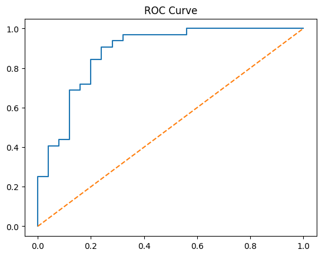
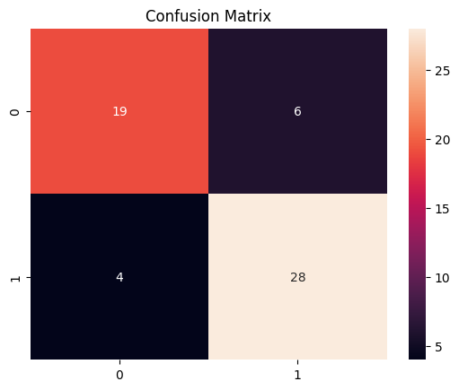

# Heart Disease Prediction

## 📌 Project Overview

This project uses machine learning to predict the likelihood of heart disease based on patient health data.

## 🎯 Objectives

* Analyze the dataset.
* Clean and preprocess the data.
* Train and compare machine learning models.
* Evaluate model performance.

## 🛠️ Tools & Technologies

* Python
* Pandas and NumPy
* Matplotlib and Seaborn
* Scikit-learn
* Streamlit

## 📊 Models

* Logistic Regression
* Decision Tree
* Random Forest
* Support Vector Machine (SVM)

## 📈 Evaluation Metrics

* Accuracy
* Precision
* Recall
* F1-score
* ROC-AUC

## 🚀 How to Run

1. Install the required libraries:
   `pip install -r requirements.txt`
2. Run the application:
   `streamlit run app.py`

## Screenshots

